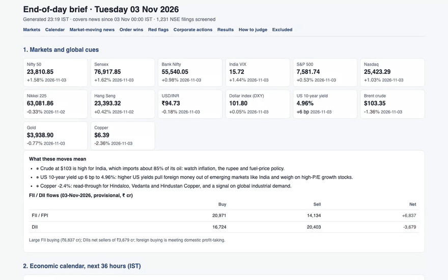

# Revathi Muppala: Research Portfolio

Senior Business Analyst and NISM-certified Research Analyst (Series XV), with an MBA (Finance) and
13 years in financial data and analytics, including nearly seven years validating listed-company
fundamentals at Thomson Reuters. I am looking for research roles in Indian capital markets, with a
focus on **equity research, fund research and financial planning**.

This repository showcases personal projects from 2024 to present. I defined each product, wrote the
specifications and built it with Claude Code.

---

## 1. Personal Wealth and Goal Tracker

A goal-based financial planning and fund research tool for Indian investors.

- Maps investments across brokers (Zerodha, Groww, Dhan, INDmoney), CAS statements (CAMS/KFintech,
  NSDL/CDSL) and manually entered assets to financial goals, and flags each goal as on track or at risk.
- Projects lump-sum, SIP and step-up SIP contributions, with a Monte Carlo probability of reaching
  each goal.
- A **what-if simulator** previews the effect of extra investments, a shorter timeline or a smaller target.
- Shows each goal's portfolio composition by sector and market cap.
- Compares mutual funds with their category peers and benchmark.
- Reports realised and unrealised P&L and capital-gains tax estimates per tax account (self, spouse, HUF).

**Demo** (sample household, not real data): goals dashboard → retirement goal and portfolio
composition → what-if simulator (an extra ₹25,000/month SIP and a ₹5 lakh lump sum raise the
probability of reaching the target from 22.7% to 48.9%) → assets → tax optimization.

[Watch in higher quality (MP4)](docs/demo/goal_tracker_demo.mp4)

---

## 2. Learning Project: Systematic Equity Strategies (Nifty 200 / Nifty 500)

Built to learn quantitative investing and AI-assisted development.

- Specified 30-stock momentum and alpha portfolios drawn from the Nifty 200 and Nifty 500.
- Back-tested each strategy version against pre-set pass criteria and evaluated it on CAGR,
  Sharpe, Sortino, Jensen's alpha and maximum drawdown.
- Set up paper-trading portfolios to forward-test the strategies against the Nifty Alpha 30.

**Demo:** backtest library with pass/fail verdicts → one strategy version's pass criteria and
trials → paper-trading books with risk-adjusted performance.

[Watch in higher quality (MP4)](docs/demo/backtests_demo.mp4)

> All backtest and paper-trading results are simulated. They are not real trades or investment advice.

---

## 3. Market Newsdesk: End-of-Day Market Brief

A daily brief on Indian markets, built from free public sources and published after each trading day.

- **Markets and global cues:** Nifty, Sensex, Bank Nifty, VIX, rupee, US yields, crude, gold and global indices,
  with what each big move means for Indian sectors, and FII/DII flows.
- **Economic calendar:** high-impact global events for the next 36 hours, with why each matters for India.
- **Market-moving news:** the top stories with real market impact, every policy-relevant Finance Minister
  statement, and capital-markets regulatory news (SEBI, exchanges, RBI rules on markets).
- **Exchange filings:** all ~1,200 NSE filings of the day screened for what matters to an investor:
  - **Order wins:** the order value is read from the filing PDF, including scanned filings via OCR, and judged
    on yearly revenue impact.
  - **Red flags:** auditor exits, insolvency, tax and legal orders.
  - **Corporate actions and results.**
  - **Noise:** routine filings are excluded and counted, with the reason.
- **Summaries and analyst insights:** for every material filing. Examples from 3 Nov 2026:
  - JNK India's "Major" order came from its promoter, so it is a related-party order.
  - LCC Projects' ₹703 crore order includes 10 years of maintenance, so construction revenue is lower than the headline.

**Live briefs:** [revathimuppala.github.io/market-briefs](https://revathimuppala.github.io/market-briefs/)

**Demo:** calendar → market-moving news → order wins with value, materiality and insight → red flags →
corporate actions → excluded noise.

[Watch in higher quality (MP4)](docs/demo/market_newsdesk_demo.mp4)

> Personal research, not investment advice. Summaries and insights are machine-assisted from public filings
> and news; always check the original source.

---

## Skills shown

- **Equity research:** industry and company analysis, financial statements, annual reports and
  management discussion, ratio analysis, relative valuation, peer comparison
- **Fund research:** category peer comparison, portfolio holdings, risk and return measures
  (Sharpe, Sortino, drawdown)
- **Financial planning:** goal-based planning, SIP and step-up SIP projections, what-if scenarios
- **Market monitoring:** exchange filings and corporate disclosures, materiality and red-flag screening,
  macro, policy and regulatory news analysis
- **Data and tools:** SQL, Power BI, Excel, Thomson Reuters Eikon, Claude Code
